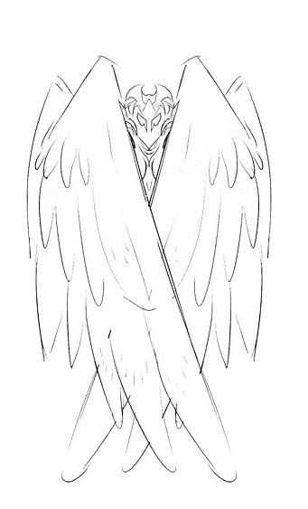
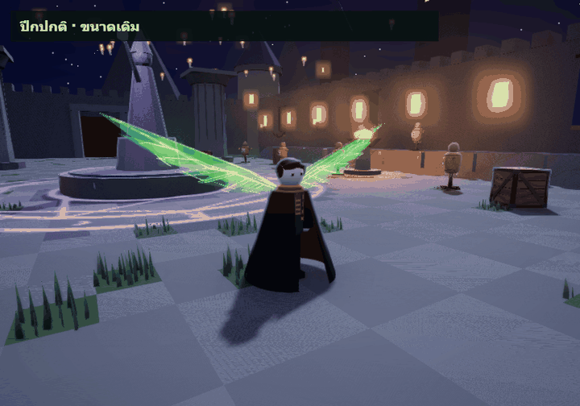
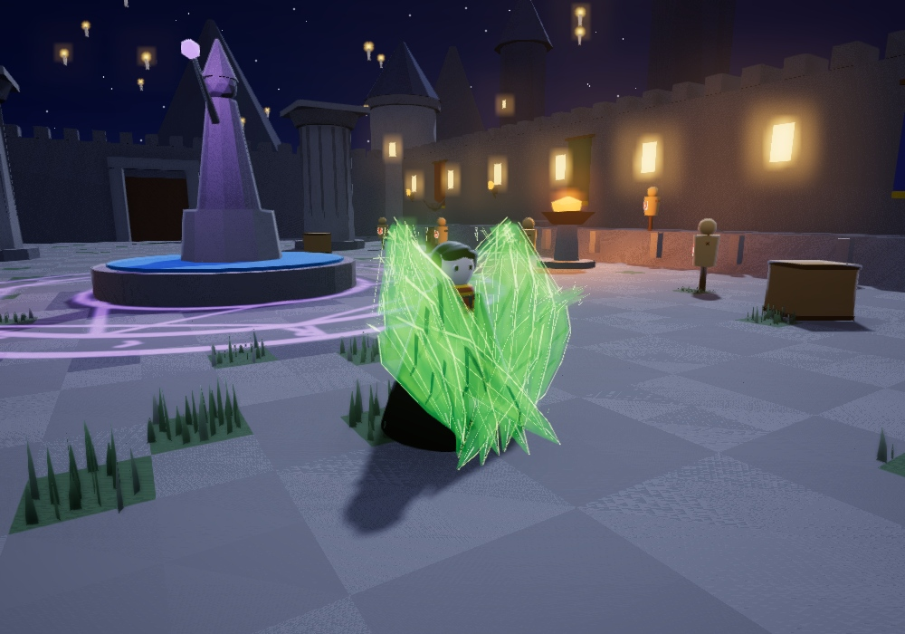
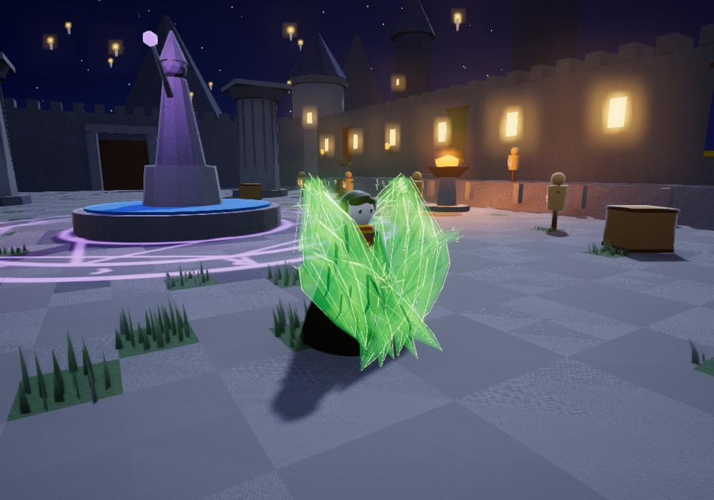
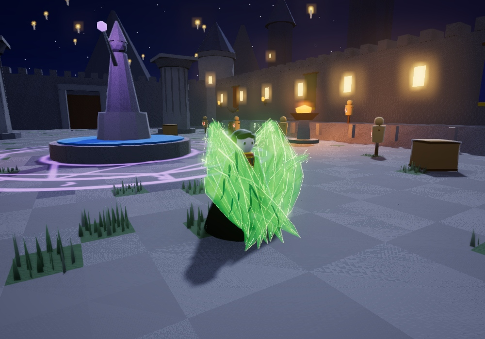
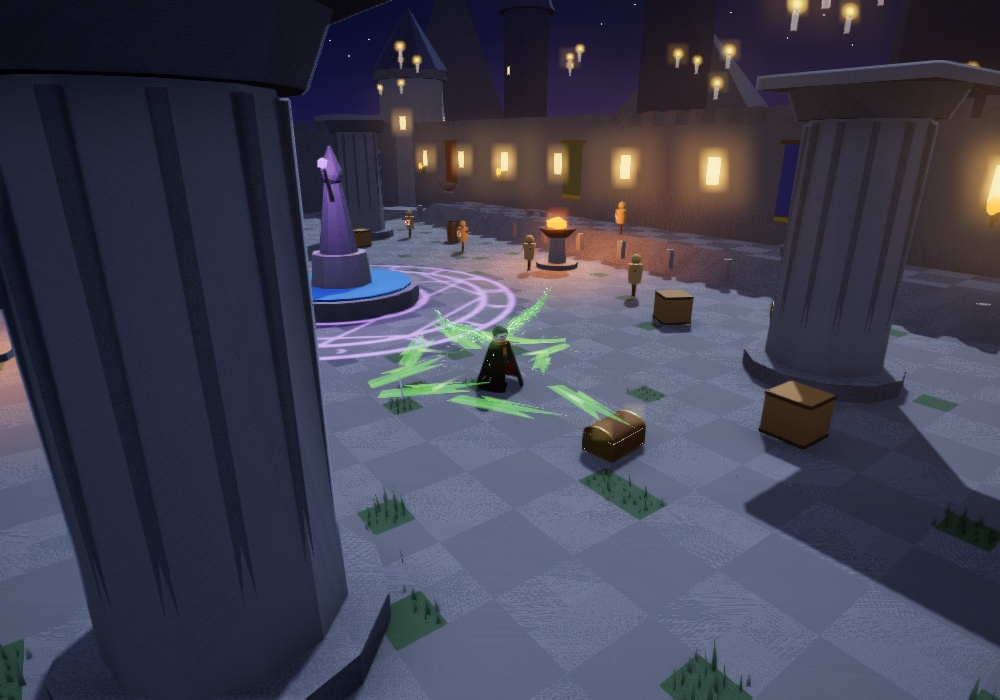
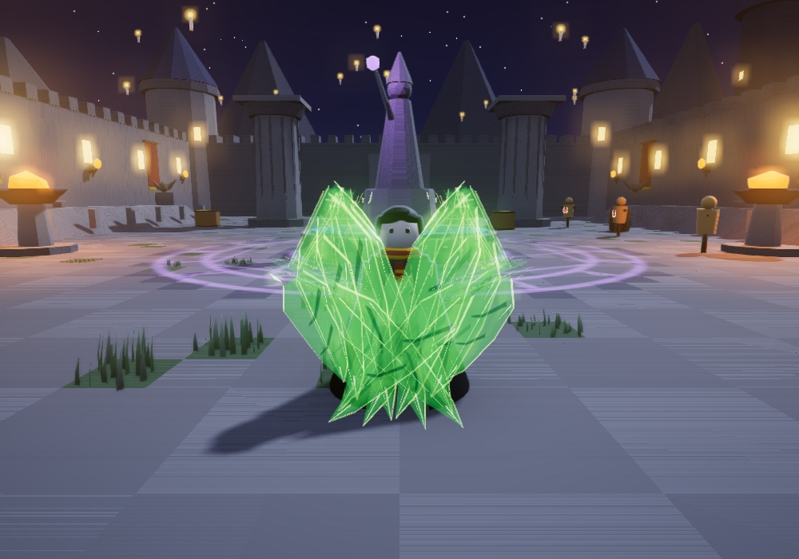
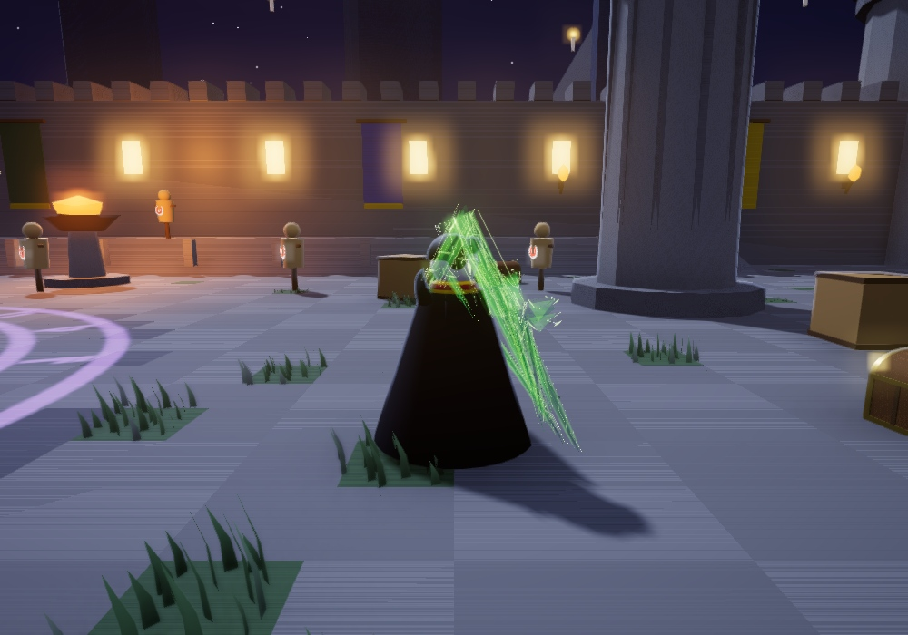
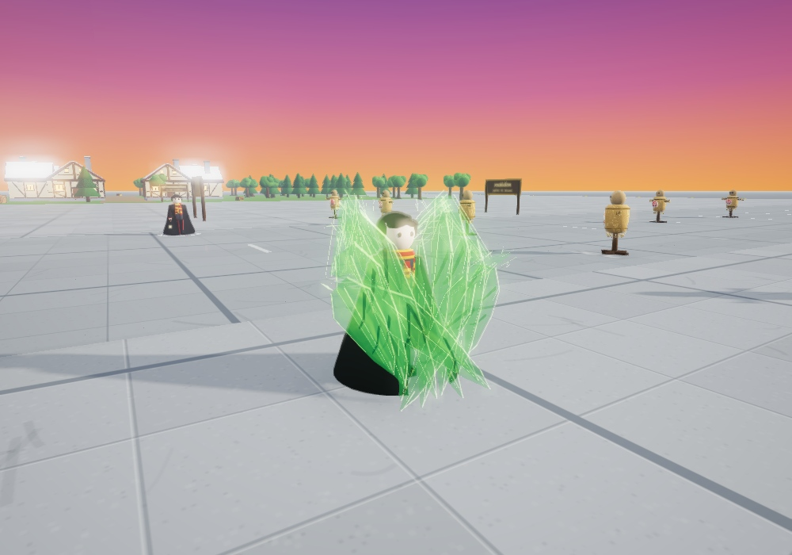

# Wind — โล่ปีกลม

ตัวอย่าง VFX และแอนิเมชันใน Studio สำหรับรีวิวรอบใหม่ ตามภาพปีกพับห่อเต็มตัวของผู้ใช้ ปีกปกติยังขนาดเดิม ส่วนขนลมด้านล่างยืดยาวเฉพาะตอนป้องกัน เป็นแผ่นเหลี่ยมซ้อนเหลื่อมเขียวนีออนโปร่ง มีเงาเข้มแบ่งแต่ละแผ่นและไฮไลต์ขาวเล็กน้อย

**สถานะ:** แบบโล่แคบช่วงคอ/ลำตัวเดิมถูกแทนที่แล้ว ภาพเรนเดอร์และการตรวจรอบใหม่เสร็จแล้ว ผู้ใช้ยังไม่ได้อนุมัติภาพสุดท้าย

## ภาพอ้างอิงจากผู้ใช้

## จังหวะการเคลื่อนไหว

- **ขนลมขยายทันที:** ขนลมยาว 6 ชิ้นต่อข้างเริ่มยืดระหว่าง .25–.51 วินาที แล้วพับตามปีกหลัก โดยไม่ขยายขนาดปีกปกติหรือยืดทั้งแผ่นหลัก
- **ห่อป้องกันเต็มตัว:** ยอดปีกอยู่เหนือศีรษะ ขนลมด้านล่างแผ่เป็นแผ่นยาวซ้อนเหลื่อม ห่อด้านหน้าและไขว้ลงถึงหน้าแข้ง แต่ละชิ้นยึดกับข้อปีกที่กำลังขยับ
- **รับแรง:** จุดกระทบวาบขาวสั้น ๆ พร้อมสะเก็ดลม ปีกสะเทือนเล็กน้อย และประกายวิ่งกลับตามข้อปีกถึงโคน
- **สะสมพลัง:** เส้นเขียวนีออนบนสันปีกค่อย ๆ สว่างขึ้น โดยรักษาความโปร่งของเนื้อปีก
- **ปล่อยพลัง:** หุบอัดสั้น ๆ แล้วสะบัดกางแรง ปล่อยแฉกลมแยกชิ้นกวาดออกโดยมีช่องว่างระหว่างแฉก แผ่นหลักหุบอัด 10% เฉพาะช่วงนี้
- **คืนท่า:** ขนลมยาวหดกลับ แรงสะบัดค่อย ๆ หยุด ปีกขนาดปกติกลับกางค้างและขยับเพียงเล็กน้อย

## ตัวอย่างภาพ

[เปิดหน้ารวมภาพ](wind-shield-vfx-review.html) · [เปิดใน VFX Studio](http://localhost:8765/index.html?studio&fx=wind/shield_wing&at=self&map=test)

| ปีกห่อป้องกัน | รับแรงกระทบ |
| --- | --- |
|  |  |
| **หุบอัดลม** | **สะบัดกางปล่อยพลัง** |
|  |  |

| ด้านหน้า | ด้านข้าง | พื้นหลังสว่าง |
| --- | --- | --- |
|  |  |  |

## ไฟล์และขอบเขต

- Generator: `tools/wind-shield-study.py`
- Geometry preparation: `tools/wind-shield-geometry.py`
- Effect: `assets/fx/wind/shield_wing.fx.json`
- Geometry: `assets/fx/mesh/wind_shield_{R,L}_{body,flow,spines,cuts,feathers,accents}_{0,1,2}.mesh.json` รวม 36 ชิ้น, `wind_shield_burst.mesh.json` และโมเดลขนลมยาวต้นแบบใหม่ 5 ชิ้น
- เดโมยาว **5.6 วินาที**; จำลองโดนตีที่ **1.25 / 1.82 / 2.38 วินาที** และเริ่มปล่อยพลังที่ **3.56 วินาที**
- เวลาเหล่านี้ใช้จัดจังหวะภาพในเดโม ยังไม่ผูกเข้าการเล่นจริง และไม่ได้เปลี่ยนกลไกเกม
- ขนาดปีกปกติและมิติแผ่นหลักคงเดิม ขนลมยาวปรากฏเฉพาะจังหวะ Guard และหดเมื่อปล่อยพลัง

## สถานะการตรวจรอบใหม่

- อัปเดตภาพ Guard / Hit / Compress / Release / Rest พร้อมภาพด้านหน้า ด้านข้าง และพื้นหลังสว่างแล้ว
- Dark capture 8 ภาพ: 0 page errors, white 0%; motion capture 112 เฟรมที่ 20 fps / 5.6 วินาที: 0 page errors
- Bright capture: Guard ที่ 1.05 วินาที white 0.227%; Release ที่ 3.91 วินาที white 0.169%; 0 page errors และ lint ว่าง
- Motion และ bright capture มีความล้มเหลวชั่วคราวตอนดึง source ในครั้งแรก จากนั้น retry สำเร็จ; ค่าข้างต้นเป็นผลของรอบที่สำเร็จ
- GIF เต็ม `storyboard/img/wind_shield_motion.gif`: 720×504, 112 เฟรม, 6.78 MiB
- GIF เน้นช่วงขยาย/หด `storyboard/img/wind_shield_guard_focus.gif`: 55 เฟรม, 2.75 วินาที, 3.45 MiB
- Syntax check ผ่าน: 67 ไฟล์ / 17,767 บรรทัด; fx-check: 133 effects, 116 models, 30 textures, 2 volumes, 0 errors / 0 warnings; codemap regenerated และ `git diff --check` ผ่าน
- จำนวนครั้งรับแรงและช่วงแสดงเกจเต็มจัดขึ้นเพื่อสาธิตภาพ ไม่เปลี่ยน +10% GaleBurst ต่อการบล็อกหรือกติกาสกิลเดิม
- รอผู้ใช้รีวิวภาพก่อนตัดสินใจขั้นถัดไป
